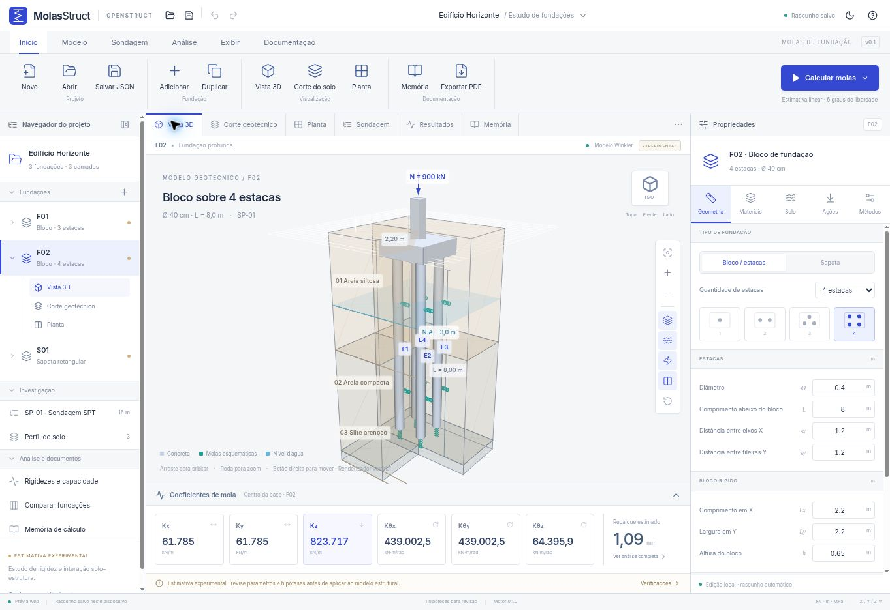
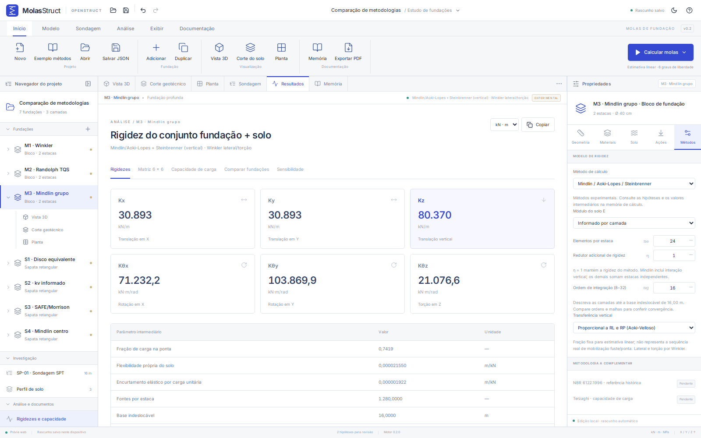

<div align="center">


# MolasStruct

**Da sondagem ao apoio elástico.**

Estimativa de rigidez de fundações com visualização 3D, perfil SPT e memória de cálculo.

[](https://github.com/ricardocorsini/mola-struct/actions/workflows/check.yml)
[](LICENSE)
[](CHANGELOG.md)
[](#estado-do-projeto)

Parte do ecossistema **OpenStruct** · Engenharia estrutural aberta

[Começar](#começar) · [Métodos](#métodos-de-cálculo) · [Documentação](#documentação) · [Contribuir](CONTRIBUTING.md)

</div>



## Sobre

O MolasStruct auxilia o estudo da rigidez do conjunto **fundação + solo** e sua representação por apoios elásticos em modelos estruturais. Permite definir geometria, materiais, ações, sondagem SPT e camadas para comparar estimativas de translação e rotação de **sapatas retangulares** e **blocos sobre 1 a 4 estacas**.

A aplicação funciona no navegador e possui uma base desktop com Tauri. O cálculo é local: não depende de uma API de engenharia nem envia o perfil de solo a um servidor. A interface segue a organização do ConsoloStruct, com faixa de ferramentas, árvore de projeto, vistas sincronizadas, propriedades e resultados.

## Estado do projeto

**v0.4.0 — experimental.** Há cálculos implementados e testes com referências analíticas idealizadas. A validação geotécnica com provas de carga e a verificação de conformidade normativa ainda não estão concluídas. As hipóteses estão na memória e em [MOTOR.md](docs/MOTOR.md).

Os exemplos de demonstração são fictícios; o caso externo de 16 m é identificado separadamente. Os parâmetros de deformabilidade e reação precisam de justificativa para o solo, a fundação e o nível de deformação em análise. O bloco é considerado rígido; seu dimensionamento estrutural não faz parte desta versão.

## Funcionalidades

- **Fundações:** sapatas e blocos sobre 1 a 4 estacas; dimensões, espaçamentos, cotas, concreto e ações editáveis.
- **Investigação:** SPT, camadas, importação CSV/TSV, colagem de planilhas e nível d'água.
- **Visualização:** modelo 3D com órbita, zoom, pan e vistas predefinidas; solo em corte, água, cotas e molas esquemáticas; planta e corte vetoriais.
- **Análise:** seis coeficientes, matriz **6 × 6** com acoplamentos, deslocamentos, rotações, capacidade estimada, comparação e sensibilidade.
- **Documentação:** memória na interface e PDF; matriz e SPT em CSV, geometria DXF, desenhos SVG e projeto JSON versionado.
- **Projeto:** múltiplas fundações, duplicação, desfazer/refazer, rascunho local e temas claro/escuro.

## Começar

### Versão web

Requisitos: [Node.js](https://nodejs.org/) **22.12+**, npm e navegador moderno. WebGL é recomendado; há um renderizador vetorial de contingência.

```bash
git clone https://github.com/ricardocorsini/mola-struct.git
cd mola-struct
npm ci
npm run dev
```

Abra **http://127.0.0.1:1420**. O exemplo inicial contém uma sondagem fictícia, dois blocos e uma sapata.

### Compilação local

```bash
npm run build
npm run serve
```

O servidor usa o mesmo endereço. Depois do build, `INICIAR_WEB.sh` (Linux/macOS) e `INICIAR_WEB.bat` (Windows) também iniciam a aplicação. **`dist/` é gerada localmente e não é versionada**; não abra seu `index.html` diretamente pelo sistema de arquivos.

As fontes e bibliotecas ficam no pacote compilado. Após instalar e compilar, é possível executar a versão local sem internet. O rascunho pertence ao navegador/origem atual; use **Salvar JSON** para transportar e manter uma cópia do projeto.

### Desktop com Tauri

Além de Node.js, instale **Rust estável** e os [pré-requisitos do Tauri](https://v2.tauri.app/start/prerequisites/) para seu sistema.

```bash
npm ci
npm run desktop:dev
```

Para gerar os pacotes no sistema atual:

```bash
npm run desktop:build
```

Os artefatos ficam em `src-tauri/target/release/bundle/`. O workflow manual [Desktop](.github/workflows/desktop.yml) configura builds para Windows, Linux e macOS e disponibiliza os artefatos no GitHub Actions, sem publicar releases automaticamente. **Não há instalador desktop validado nesta versão**; os testes do núcleo Rust são independentes da interface nativa.

## Métodos de cálculo

| Recurso                             | Implementação atual                                                                                                |
| ----------------------------------- | ------------------------------------------------------------------------------------------------------------------ |
| Rigidez das estacas                 | Viga de Euler–Bernoulli e barras axial/torsional em Winkler; reação distribuída e condensação no topo              |
| Bloco sobre estacas                 | Bloco rígido com molas independentes ou flexibilidade vertical mútua no perfil Mindlin; redutor manual η           |
| Capacidade de estaca isolada        | Aoki–Velloso por intervalos SPT e camadas, com F₁/F₂, α e K informados                                             |
| Translações da sapata               | Semiespaço elástico com disco de mesma área e homogeneização explícita de E e ν                                    |
| Rotações da sapata                  | Winkler distribuído sobre o retângulo                                                                              |
| Tensão última da sapata             | Fatores de Vésic e de forma, para carga vertical centrada; demais fatores unitários                                |
| Correlação SPT                      | Referência exploratória `qSPT = C × N`, com C informado e sem atribuição normativa                                 |
| Mindlin / Aoki–Lopes / Steinbrenner | Recalque vertical por superposição, camada finita, encurtamento EA e interação vertical no grupo                   |
| Randolph–Wroth simplificado (TQS)   | Parcela de fuste publicada pelo TQS; Kh proporcional e rotação sem braço por 0,5·3EI/L                             |
| Sapatas por kv / SAFE-Morrison      | kv informado ou correlação com σadm; unidades originais e domínio controlados                                      |
| SPT → E                             | Opcional: Schmertmann (3 K_E N̄) ou E0 inicial de Aoki (6/4/3 K_AV N̄), com unidades e execução explícitas           |
| Conferência parcial NBR 6122:2022   | Ações ELS/ELU separadas, limites justificados, fatores da via simples, processo executivo e pendências rastreáveis |
| Terzaghi                            | **Pendente**; não gera resultados                                                                                  |

A capacidade é calculada separadamente da rigidez. Em Mindlin, as resistências Aoki–Velloso podem definir a **proporção fixa** de carga transferida ao fuste/ponta; isso não constitui mobilização não linear. E pode ser informado ou estimado pela correlação SPT selecionada; ν e os coeficientes Winkler são informados.

Em **Início → Exemplo métodos**, carregue uma comparação com a mesma geometria por família. Em **Propriedades → Métodos**, escolha o modelo. O exemplo também está em [comparacao-metodologias.molas.json](examples/comparacao-metodologias.molas.json). Projetos v1 antigos continuam com Winkler/disco equivalente até uma escolha explícita.



A revisão dos materiais e o caso do print estão em [METODOLOGIAS.md](docs/METODOLOGIAS.md). Mindlin é vertical: lateral e torção das estacas usam Winkler. A sapata Mindlin usa recalque no **centro sob pressão uniforme**, com rotações aproximadas por kv I; não resolve o contato de um punção rígido. Não há comprovação de equivalência completa com o TQS ou com a calculadora do print.

### Comparar o caso externo de 16 m

Em **Início → Exemplo 16 m**, carregue as duas estacas Ø30 cm, F1=2, F2=4, carga total de 40 tf e NSPT(11)=17. **Resultados → Comparar print** mostra os alvos externos ao lado das saídas calculadas e separa a contribuição axial da flexão local.

As resistências conferem: **43,5048 / 40,8211 / 84,3258 tf**. As molas ainda divergem: Kz=22.736,93 contra 21.538,54 tf/m (+5,56%) sob as hipóteses atuais. Ec, unidades de E, solo abaixo de 20 m e formulações lateral/rotacional precisam de equivalência; não há selo de validação para essas linhas. Veja a [transcrição, comparação e pendências](docs/REFERENCIA-16M.md).

A [investigação de Kθy](docs/INVESTIGACAO-ROTACAO.md) decompõe a diferença em flexão local, interação modal e nível de Kz, com 30 ensaios de hipóteses reproduzíveis por `npm run investigate:rotation`. O motor permanece preservado.

A correlação da foto **E0=6/4/3 K_AV N̄** está disponível para estacas. É módulo inicial, sem atualização por tensões. O caso externo mantém E manual; não se extrapola SPT de 20 até 100 m para aplicar a correlação.

### Conferência com a NBR 6122:2022

Em **Resultados → NBR 6122:2022**, registre a origem das ações de serviço, limites justificados e um vetor ELU separado. A conferência controla fatores da via simples, distingue a resistência de ponta por execução e identifica contato parcial, grupo e outras verificações ainda fora do escopo. Declarações do usuário aparecem separadas dos critérios calculados; não há aprovação integral automática.

A norma não fornece valores universais de molas nem valida sozinha os métodos de recalque. Veja a [revisão normativa e os dados que ainda faltam](docs/NBR6122-2022.md). O PDF da norma não é redistribuído. Há um [exemplo fictício de conferência](examples/nbr6122-conferencia.molas.json), com limites e declarações apenas didáticos.


### Unidades e convenções

- Unidades internas: **kN, m e rad**. E do solo em MPa; Ec do concreto em GPa.
- X e Y no plano; Z para cima. Profundidades positivas para baixo.
- N positivo em compressão entra no vetor de ações como `Fz = −N`.
- A diagonal `Kii` considera os demais graus de liberdade impedidos. Em blocos sobre estacas, preserve a **matriz completa** para representar os acoplamentos.

Consulte equações, condições de contorno e limites em [MOTOR.md](docs/MOTOR.md).

### Confiabilidade e validação independente

A [revisão de confiabilidade](docs/CONFIABILIDADE.md) relaciona referências primárias, hipóteses atuais e critérios de validação. Uma conferência externa com OpenSees verificou as matrizes 6 × 6 de três modelos Winkler lineares; com refinamento, o maior erro normalizado ficou entre **0,01395% e 0,01558%**. Isso verifica a montagem nesses casos, sem validar parâmetros do solo ou a rigidez vertical Mindlin do print.

As referências numéricas externas estão congeladas em `tests/fixtures/opensees-winkler.json`. O workflow [Independent Winkler verification](.github/workflows/verify-independent.yml) permite reproduzir a comparação. OpenSees não é dependência de execução do aplicativo.

## Desenvolvimento e testes

| Comando                                 | Finalidade                                |
| --------------------------------------- | ----------------------------------------- |
| `npm run dev`                           | Desenvolvimento com Vite                  |
| `npm run check`                         | TypeScript estrito e testes Vitest        |
| `npm run test:core`                     | Testes Rust; requer Cargo                 |
| `npm run build`                         | Compilação web de produção                |
| `npm run serve`                         | Servir a pasta `dist/` localmente         |
| `npm run examples:generate`             | Regenerar exemplos e casos de paridade    |
| `npm run format` / `format:check`       | Formatar / conferir formatação            |
| `npm run desktop:dev` / `desktop:build` | Desenvolver / compilar o aplicativo Tauri |

Os testes cobrem referências analíticas, equilíbrio, simetria, conservação das reações, entradas inválidas, arquivos e paridade entre motores. Veja [VALIDACAO.md](docs/VALIDACAO.md) para distinguir testes de software, validação de engenharia e distribuição desktop.

## Stack e arquitetura

**React 19 · TypeScript · Vite 7 · Tailwind CSS 4 · Three.js · Tauri 2 · Rust**

| Caminho              | Responsabilidade                                            |
| -------------------- | ----------------------------------------------------------- |
| `src/domain/`        | Modelo validado, unidades, solver web e adaptador nativo    |
| `src/components/`    | Interface, propriedades, vistas e resultados                |
| `src/files.ts`       | Importação e exportações                                    |
| `crates/molas-core/` | Núcleo Rust independente do Tauri                           |
| `src-tauri/`         | Janela desktop, permissões e comando `foundation_stiffness` |
| `tests/`             | Testes TypeScript e referências de comportamento            |
| `examples/`          | Dados fictícios, resultados e exportações reproduzíveis     |
| `docs/`              | Métodos, validação, roadmap e recursos de documentação      |
| `.github/`           | CI, build desktop e modelos de colaboração                  |

Na web, a rigidez é calculada em TypeScript. No desktop, a matriz vem do Rust e é comparada à implementação web; divergências bloqueiam resultados nativos. Capacidade geotécnica e exportações permanecem no módulo TypeScript.

## Documentação

- [Métodos, equações e hipóteses](docs/MOTOR.md)
- [Funcionalidades](docs/FUNCIONALIDADES.md)
- [Validação e limites conhecidos](docs/VALIDACAO.md)
- [Exemplos](examples/README.md)
- [Roadmap](docs/ROADMAP.md)
- [Histórico de mudanças](CHANGELOG.md)

## Contribuir

Contribuições de código, documentação, referências e casos de validação são bem-vindas. Leia [CONTRIBUTING.md](CONTRIBUTING.md) e o [código de conduta](CODE_OF_CONDUCT.md). Use as [issues](https://github.com/ricardocorsini/mola-struct/issues/new/choose) para relatar problemas e propor melhorias.

Em alterações de engenharia, inclua hipóteses, unidades, referência e resultado independente esperado. Utilize dados fictícios ou anonimizados nos exemplos públicos. Para questões de segurança, consulte [SECURITY.md](SECURITY.md).

## Licença e créditos

[Licença MIT](LICENSE). Desenvolvido por **Ricardo Corsini e colaboradores**, no ecossistema OpenStruct. A estrutura inicial compartilha decisões e componentes do ConsoloStruct/LumeConsolo; seus avisos de autoria foram preservados.

Bibliotecas e fontes mantêm suas licenças: [THIRD_PARTY_NOTICES.md](docs/THIRD_PARTY_NOTICES.md). Para citar o software em trabalhos, utilize [CITATION.cff](CITATION.cff).
